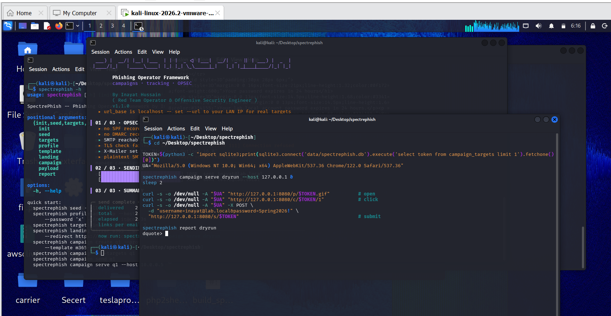
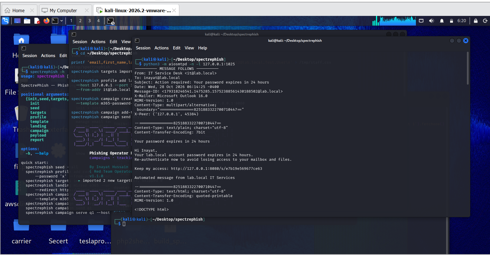
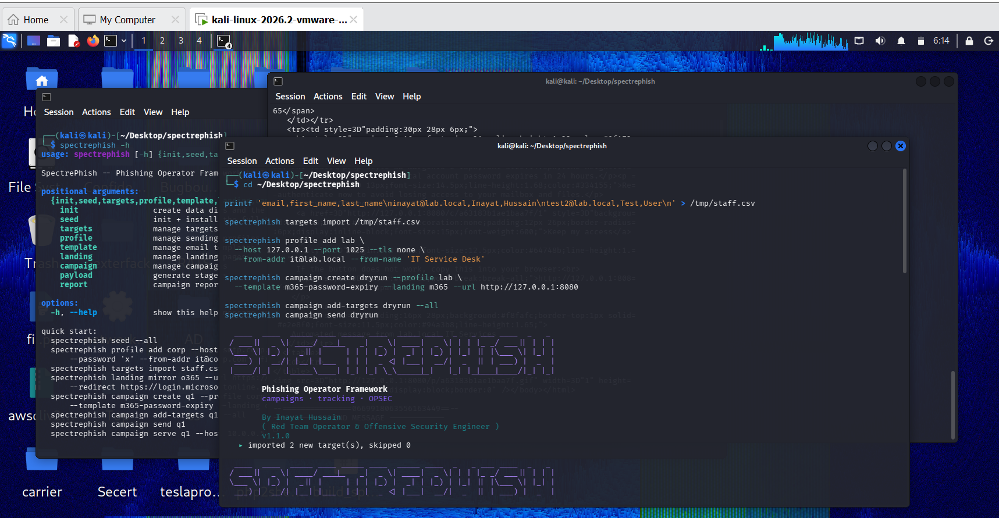
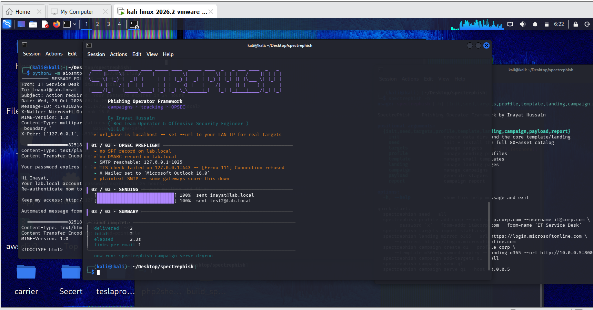
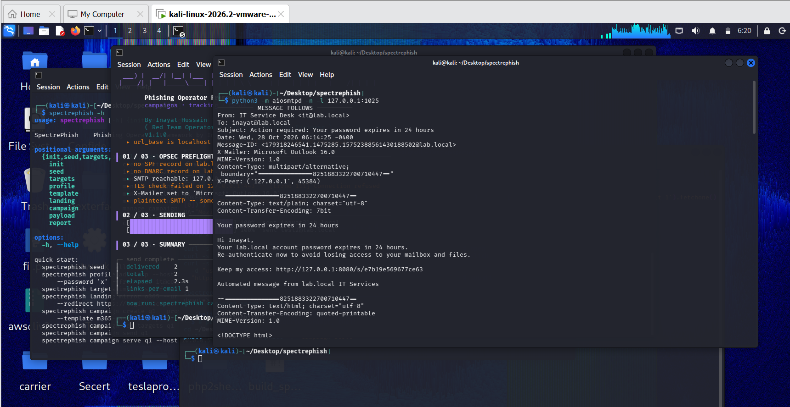
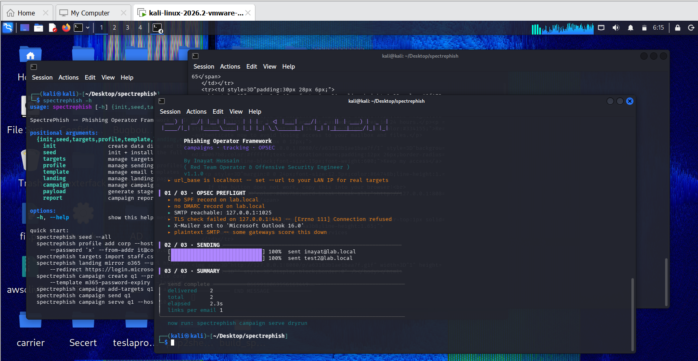
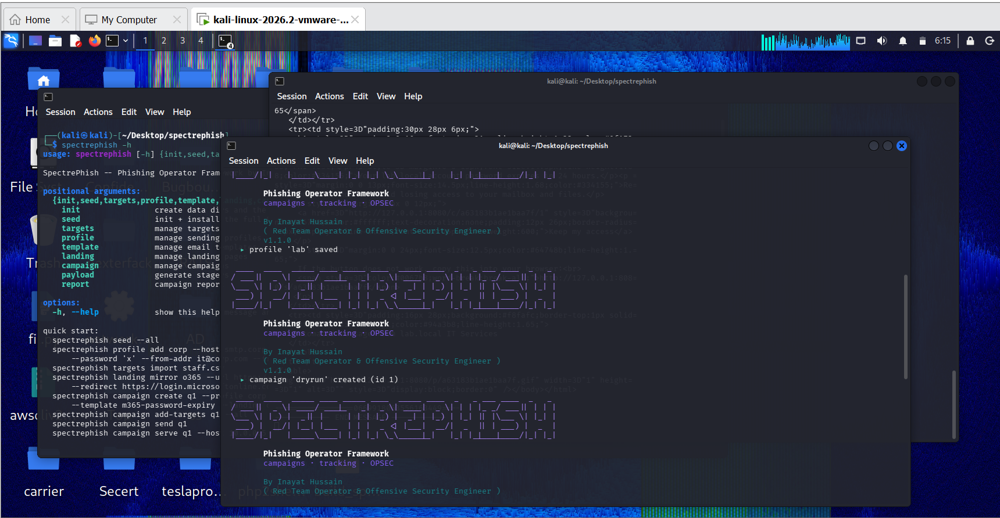

# SpectrePhish

### Phishing Operator Framework for Red Team Operations

**60 Email Templates · 80-Asset Catalog · Campaign Management · Landing Pages · OPSEC Diagnostics · Reporting**

SpectrePhish is a Python-based phishing operator framework built for authorized red-team operations and security assessments. It brings together email-template generation, asset seeding, target management, mail-profile configuration, landing-page management, campaign operations, operational diagnostics, and reporting through a unified command-line interface.

Designed for operators who need a structured workflow, SpectrePhish combines reusable campaign assets with configurable infrastructure and centralized results.

## Core Capabilities

- **60 Email Templates** — A collection of templates for different campaign scenarios.
- **80-Asset Catalog** — Seed and install the bundled asset collection.
- **Template Generation** — Generate individual templates or work with supported categories.
- **Campaign Management** — Create and manage campaigns through the CLI.
- **Target Management** — Import and organize campaign target lists.
- **Sending Profiles** — Configure supported SMTP infrastructure.
- **Landing-Page Management** — Generate and manage landing-page assets.
- **OPSEC Diagnostics** — Inspect sender configuration and landing-page reachability.
- **Payload Module** — Access the framework's payload-generation functionality.
- **Live Event Monitoring** — Inspect campaign events where supported by the implementation.
- **Reporting and Export** — Review results and export campaign reports.

## Screenshots















## Installation

```bash
git clone https://github.com/InayatHussain09/spectrephish.git
cd spectrephish

python3 -m venv .venv
source .venv/bin/activate

python -m pip install --upgrade pip
pip install -r requirements.txt
```

Ensure that Python and the project's dependencies are installed correctly. If the CLI command is unavailable, inspect `pyproject.toml` for the configured entry point.

## Quick Start

Initialize the framework:

```bash
spectrephish init
```

Install the bundled asset catalog:

```bash
spectrephish seed --all
```

Explore the CLI:

```bash
spectrephish --help
```

Browse template categories:

```bash
spectrephish template categories
```

Generate templates by category:

```bash
spectrephish template generate --category Finance
```

Generate the available template collection:

```bash
spectrephish template generate --all
```

Explore landing-page generation options:

```bash
spectrephish landing generate --help
```

## WAN Operations: The Rule That Matters

**The campaign URL is resolved by the recipient's browser, not by the operator's terminal.**

- `127.0.0.1` refers to the device opening the URL.
- `10.0.0.5` is a private address and works only where network routing permits.
- A public hostname or IP requires working DNS or addressing, routing, firewall configuration, and a reachable service.
- HTTPS requires a correctly configured TLS certificate and hostname.

For authorized external assessments, validate reachability from the intended test network and use infrastructure approved for the engagement. A tunnel or VPS may provide connectivity, but neither automatically makes a service secure or reliable.

## Command Reference

| Goal | Command |
|---|---|
| Install the bundled catalog | `spectrephish seed --all` |
| Generate a template category | `spectrephish template generate --category Finance` |
| Generate all available templates | `spectrephish template generate --all` |
| Inspect landing-page options | `spectrephish landing generate --help` |
| Inspect sender diagnostics | `spectrephish profile check --help` |
| Inspect campaign operations | `spectrephish campaign --help` |
| Inspect event-serving options | `spectrephish campaign serve --help` |
| Inspect report-export options | `spectrephish report --help` |

Use the installed version's `--help` output as the source of truth for available arguments.

## Sender Configuration & Preflight

Before running an authorized campaign, validate the approved mail infrastructure and configuration.

Areas worth checking include:

| Check | Why it matters |
|---|---|
| SMTP connectivity | Confirms that the configured service can be reached |
| Authentication and relay permissions | Determines whether the service accepts the configured sender |
| SPF and DMARC | Helps identify sender-domain authentication and policy issues |
| DKIM | Checks whether the sending infrastructure provides the expected message signing |
| TLS | Helps validate encrypted connections and certificate configuration |
| Landing-page reachability | Confirms whether the intended test network can reach the configured URL |
| Rate limits | Helps prevent unexpected service rejection or disruption |

Preflight diagnostics identify potential configuration issues; they do not guarantee delivery, inbox placement, anonymity, or successful campaign tracking.

## Campaign Workflow

A typical authorized engagement involves:

1. Initialize the framework and seed the asset catalog.
2. Review the available templates and landing-page assets.
3. Configure the approved sending profile.
4. Validate connectivity and configuration.
5. Import the approved target list.
6. Create and configure the campaign.
7. Run the engagement within its documented scope.
8. Review available events and export the results.
9. Preserve required evidence and securely remove temporary data.

For exact campaign and reporting syntax, consult:

```bash
spectrephish campaign --help
spectrephish profile --help
spectrephish report --help
```

## Tracking & Reporting Considerations

Tracking events require careful interpretation.

- Message delivery does not prove that a recipient read the message.
- Open events can be generated by image proxies and automated mail-security scanners.
- Click events can also result from automated link inspection.
- Event classifications are only as reliable as the framework's detection logic.

Treat automated-scanner indicators as heuristics unless validated. Reports should clearly distinguish observed events from confirmed human actions.

## Responsible Operations

SpectrePhish is intended for authorized security work. Operators should:

- Maintain written authorization and a clearly defined scope.
- Use approved infrastructure and recipient lists.
- Protect credentials and campaign data.
- Minimize personal-data collection and retention.
- Avoid collecting real passwords or other unnecessary sensitive information.
- Follow applicable laws, organizational policies, and provider terms.
- Stop testing when an activity exceeds the authorized scope.

## Project Status

SpectrePhish is under active development. Capabilities and command options may change between versions. Verify implementation behavior in a controlled environment before relying on it in an engagement.

## Author

**Inayat Hussain**
Red Team Operator · Offensive Security Engineer · Security Researcher

GitHub: [@InayatHussain09](https://github.com/InayatHussain09)

## License

See [`LICENSE`](LICENSE) for the project's licensing terms.

